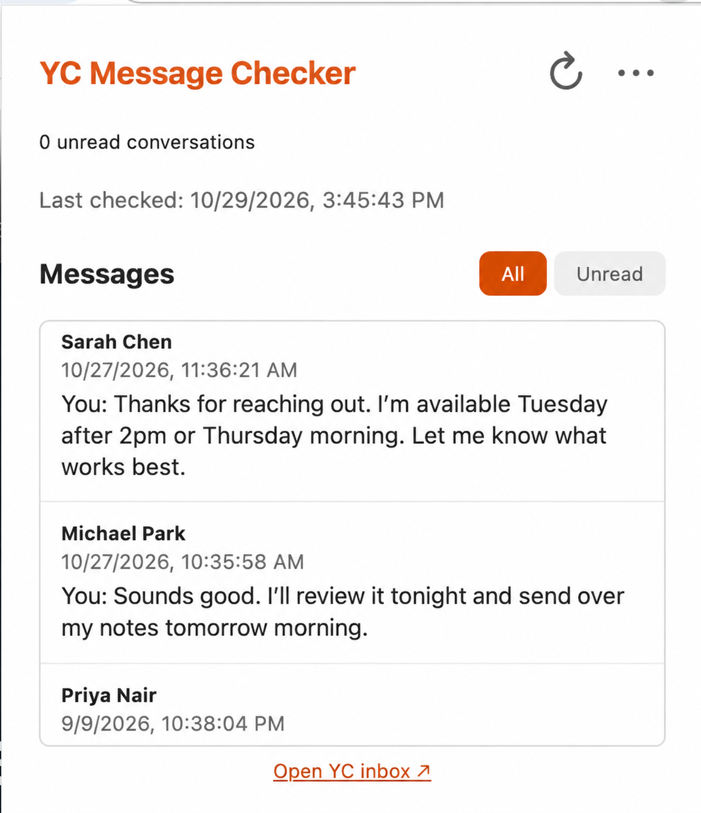

# YC Message Checker

A Chrome extension that notifies you about unread messages in your [YC Startup School co-founder matching inbox](https://www.startupschool.org/cofounder-matching/inbox).

**Version: v1.0.0** · By [Tony Su](https://im996.com/)



## Features

- Desktop notifications and an unread conversation badge.
- Previews of the latest 20 conversations, with All and Unread filters.
- Automatic checks every 1, 3, 5, or 10 minutes (default: 3), plus manual refresh.
- Uses your existing Chrome login; no need to keep the inbox tab open.
- Stores settings and previews locally. No third-party server receives your data, and messages are never sent or marked as read.

## Install

1. Download or clone this repository.
2. Sign in to [Startup School](https://www.startupschool.org/cofounder-matching/inbox) in Chrome.
3. Open `chrome://extensions` and enable **Developer mode**.
4. Click **Load unpacked** and select this repository's `extension` folder.
5. Click the extension icon to view messages. Use **…** to change settings or test notifications.

Chrome must be running for automatic checks. Allow Chrome notifications in your OS settings to see alerts. If the badge shows `!`, open the popup for details.

The extension relies on Startup School's internal API, so site changes may require updates.

## Development

Plain JavaScript, HTML, and CSS using Chrome Manifest V3. Run tests with:

```sh
node --test tests/checker.test.cjs
```
